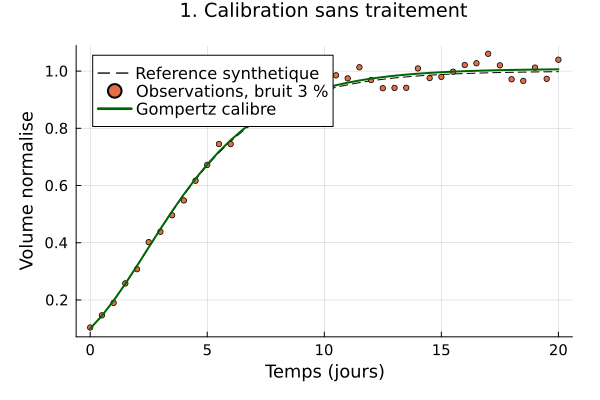
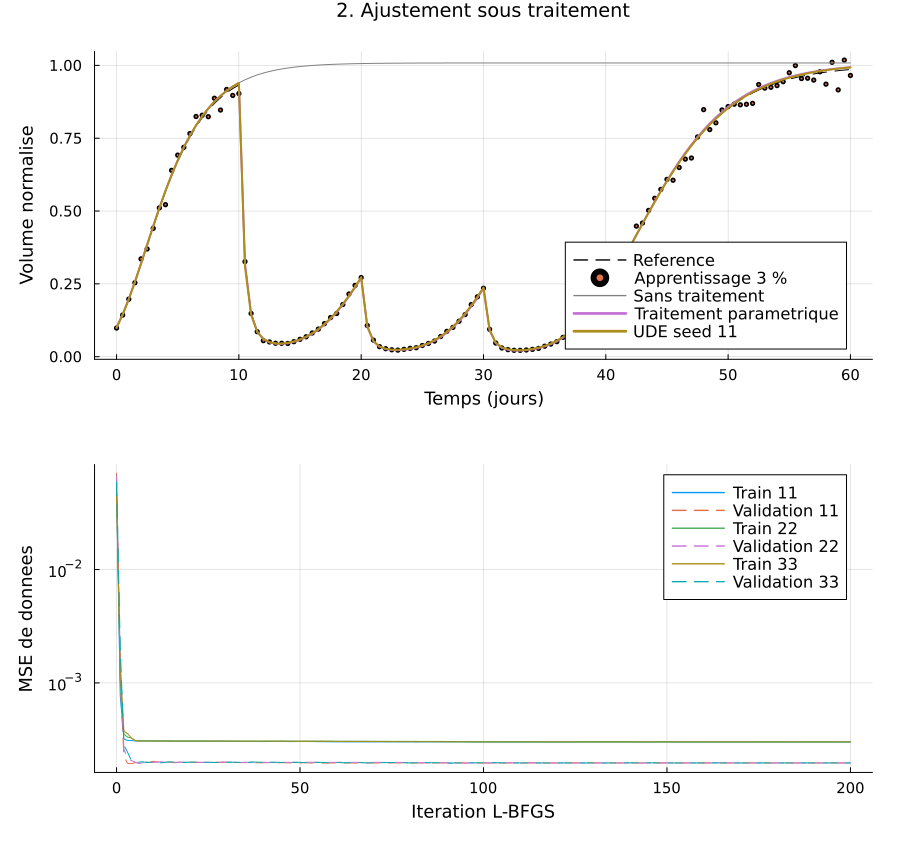
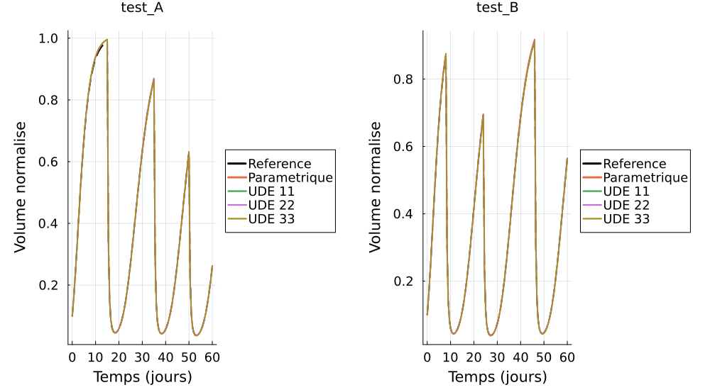

# Gompertz Growth and a Small Universal Differential Equation

A project for synthetic tumor growth and treatment response, comparing a Gompertz ODE with a hybrid mechanistic–neural model under different injection schedules.

## Model

The normalized volume $N$ follows

$$
\frac{dN}{dt}=rN\log(K/N)-\delta C(t)N,
\qquad N(0)=N_0,
$$

where the normalized treatment exposure is

$$
C(t)=\sum_j e^{-k(t-t_j)}\mathbf{1}_{t\geq t_j}.
$$

Time is measured in days. The growth rate $r$, elimination rate $k$ and treatment coefficient $\delta$ are expressed in $\mathrm{day}^{-1}$. The carrying capacity $K$ and initial volume $N_0$ are positive; injection times are nonnegative.

The growth parameters $r,K$ are estimated from untreated observations and then held fixed. The UDE replaces $\delta$ with a positive coefficient :

$$
a_\theta(N,C)=\mathrm{softplus}\left(g_\theta(x)\right),
\qquad x=(N/\widehat K,C)^\top,
$$

$$
g_\theta(x)=w_2^\top\tanh(W_1x+b_1)+b_2,
\qquad \mathrm{softplus}(s)=\log(1+e^s).
$$

The network has two inputs, eight hidden neurons and one output and $16+8+8+1=33$ parameters. Its coefficient is expressed in $\mathrm{day}^{-1}$. The factor $NC$ and the negative sign of the treatment term are imposed by the model.

## Numerical Method

The ODE is integrated using the logarithmic variable

$$
z=\log(N/\widehat K),\qquad
z'=-\widehat r z-C(t)a_\theta(\widehat K e^z,C(t)),
\qquad N=\widehat K e^z.
$$

This transformation preserves positivity in the continuous model. If $N_0\leq\widehat K$, the nonnegative treatment coefficient also keeps $N\leq\widehat K$.

Vern7 is used with `abstol=1e-10`, `reltol=1e-8`, explicit stops and declared derivative discontinuities at injection times. Analytical solutions provide reference checks for the parametric model. Solver status and finite, positive outputs are checked.

Two experiments are performed :

1. **Without treatment:** estimate $r,K>0$ from 41 observations over 20 days, using least squares and exponential parameterization.

   

2. **With treatment:** compare untreated Gompertz, a fitted constant treatment coefficient and three UDE initializations, using 121 observations per schedule over 60 days.

Synthetic observations are generated as $y_i=N(t_i)(1+0.03\epsilon_i)$, with independent standard normal $\epsilon_i$. The exact initial condition and elimination rate are known. The noise variance depends on volume; MSE is used as a fitting criterion.

L-BFGS and ForwardDiff are used to train the network with

$$
J(\theta)=\mathrm{MSE}_{\mathrm{train}}(\theta)
+10^{-6}\lVert\theta\rVert_2^2.
$$

The retained weights minimize the unpenalized validation MSE among the visited states. Network seeds 11, 22 and 33 use the same observations. Test data and noise-free reference trajectories do not select parameters.



The supplied run gives $\widehat r=0.34914114$ day⁻¹, $\widehat K=1.00839638$ and $\widehat\delta=2.52095066$ day⁻¹. The selected neural iterations are 4, 6 and 151. All three neural runs reach 200 iterations without an optimizer convergence flag. Calibration of the constant treatment coefficient converges.

| RMSE against noise-free reference | Test A | Test B |
|---|---:|---:|
| Parametric treatment | 0.0032646 | 0.0023559 |
| UDE 11 | 0.0035169 | 0.0024245 |
| UDE 22 | 0.0033022 | 0.0022201 |
| UDE 33 | 0.0037362 | 0.0029565 |



The parametric treatment model contains the law used to generate the data. These experiments illustrate the comparison.

## Project Structure

```text
src/physics.jl              Gompertz ODE, exposure and analytical reference
src/models.jl               explicit neural network, UDE and loss
src/tools.jl                synthetic data, calibration, training and CSV output

scripts/01_calibration.jl    untreated growth calibration
scripts/02_ude_traitement.jl treatment comparison and plots
test/runtests.jl            mathematical and numerical checks

Project.toml                project dependencies
Manifest.toml               pinned dependency versions
resultats/                  generated figures, predictions, scores and parameters

rapport/rapport.pdf         report
rapport/rapport.tex         LaTeX source
rapport/mesures.tex         numerical values used in the report
```

## Build

From the project root directory:

```powershell
julia --project=. -e "using Pkg; Pkg.instantiate()"
julia --project=. test/runtests.jl
julia --project=. scripts/01_calibration.jl
julia --project=. scripts/02_ude_traitement.jl
```

The first launch compiles dependencies. Run the calibration script before the treatment script, which reads its fitted growth parameters.

The test suite contains 48 assertions covering analytical solutions, injection handling, the $r=k$ limit, gradients, invalid inputs and tolerance sensitivity. The treatment script also repeats integration with tolerances 100 times tighter, keeping the selected weights fixed.

The scripts create `resultats/` with four figures and the CSV/TOML exports.

## What You Can Modify

The experiment scripts define observation times, injection schedules, random seeds, and the network's regularization coefficient and iteration limit. The synthetic data generator is defined in `src/tools.jl`.

The default physical and training parameters are :

| Parameter | Value | Description |
|---|---:|---|
| $N_0$ | 0.1 | Known initial volume |
| $r$ | 0.35 day⁻¹ | Growth rate used to generate data |
| $K$ | 1 | Carrying capacity used to generate data |
| $k$ | 0.25 day⁻¹ | Known elimination rate |
| $\delta$ | 2.5 day⁻¹ | Treatment coefficient used to generate data |
| Relative noise | 3% | Standard deviation of multiplicative noise |
| $\alpha$ | $10^{-6}$ | Network regularization coefficient |
| Iteration limit | 200 | Maximum L-BFGS iterations for each network |

The default observation schedules are :

| Role | Injection days | Noise seed |
|---|---|---:|
| Untreated calibration | None | 41 |
| Training | 10, 20, 30 | 42 |
| Validation | 12, 28, 44 | 43 |
| Test A | 15, 35, 50 | 44 |
| Test B | 8, 24, 46 | 45 |

When changing physical parameters, keep the data generator, model inputs, reference plots and exported configurations consistent. Keep training, validation and test data separate, and update the report's figures and numerical tables after changing the experiments.

## References

- C. Rackauckas et al., *Universal Differential Equations for Scientific Machine Learning* (2020). [arXiv](https://arxiv.org/abs/2001.04385)
- SciML, [Vern7 documentation](https://docs.sciml.ai/DiffEqDocs/stable/api/ordinarydiffeq/explicit/Verner/)
- [ForwardDiff.jl documentation](https://juliadiff.org/ForwardDiff.jl/stable/)
- Optim.jl, [L-BFGS documentation](https://julianlsolvers.github.io/Optim.jl/stable/algo/lbfgs/)
